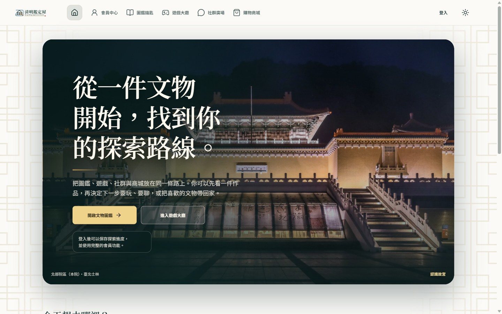
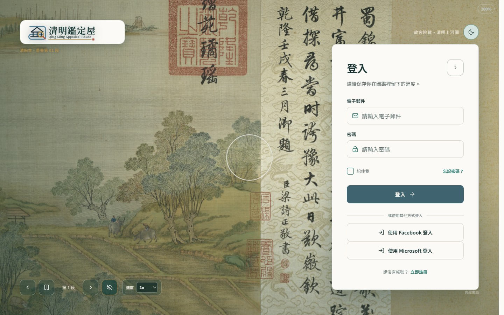
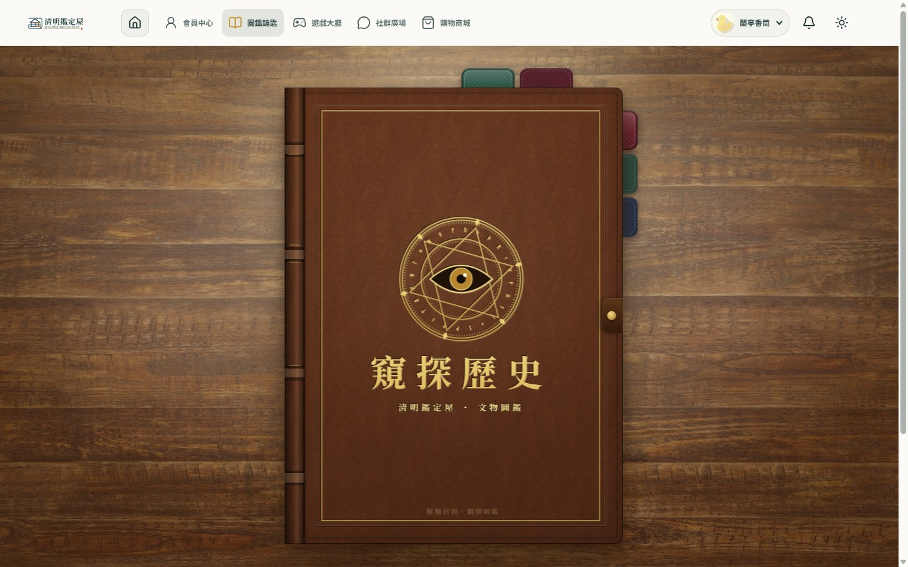
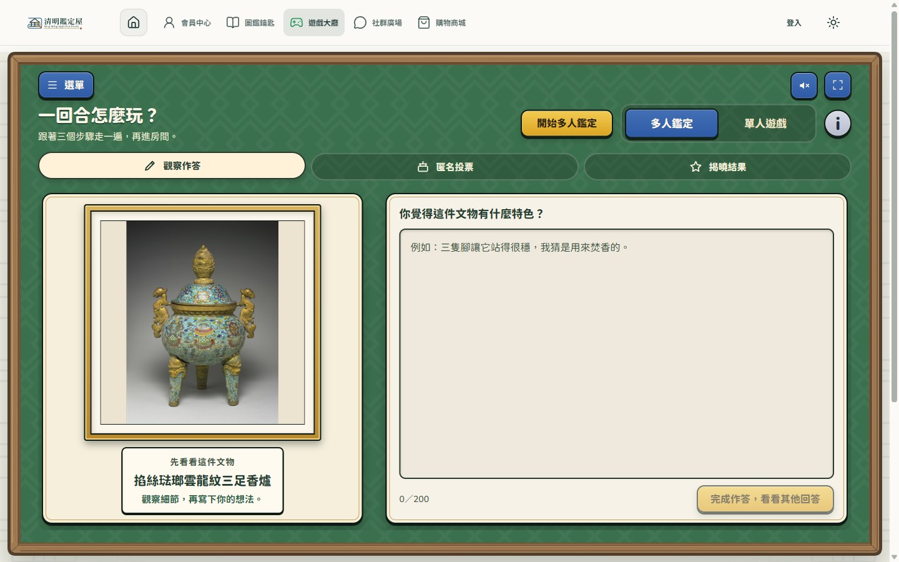
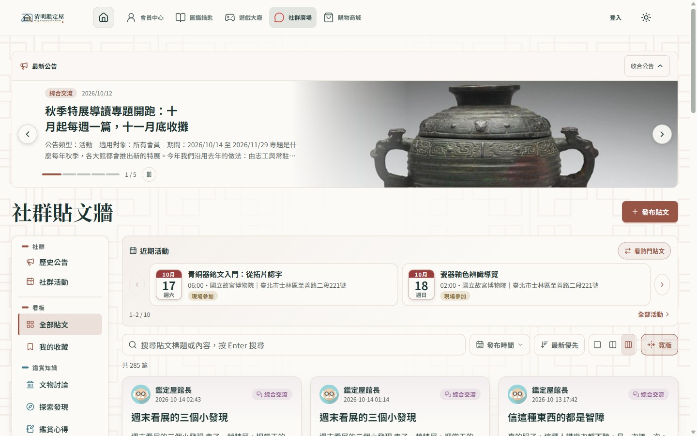
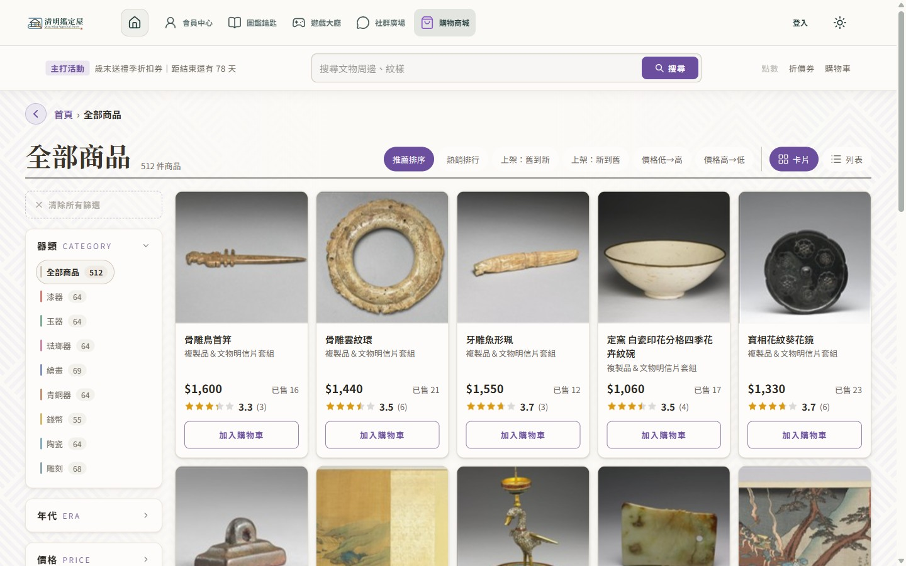
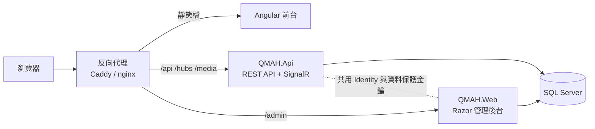

<p align="center">
  <picture>
    <source media="(prefers-color-scheme: dark)" srcset="QMAH.Media/images/brand/qmah-logo-dark.svg">
    <source media="(prefers-color-scheme: light)" srcset="QMAH.Media/images/brand/qmah-logo.svg">
    
  </picture>
</p>

# QMAH｜清明鑑定屋

[](https://github.com/MSIT173-03/QMAH/actions/workflows/build.yml)


資展國際 MSIT173 期的結訓專題，5 人團隊，2026 年 10 月發表。以國立故宮博物院的開放文物資料為基礎，有圖鑑、鑑定遊戲、社群與商城。

> **Azure 一個月免費試用期已結束，原線上展示服務因此停止。** 本倉庫保留原始碼、畫面與本地啟動方式，供專題展示與學習使用。請使用下方的 Docker 或 Visual Studio 啟動。舊展示網址已不再作為可用入口。
>
> 停服背景、雲端資源收尾及日後自行部署的注意事項見 [展示結束與維護狀態](docs/demo-retirement.md)。資安修補仍可透過 PR 提出。本專題不提供正式服務或可用性承諾。

| 首頁 | 登入 |
| --- | --- |
|  |  |
| **圖鑑** | **鑑定遊戲** |
|  |  |
| **社群廣場** | **購物商城** |
|  |  |

## 功能

| 模組 | 內容 |
| --- | --- |
| Catalog 圖鑑 | 512 件文物、8 個分類、年代與來源授權標示 |
| Game 遊戲 | 四種單人小遊戲、多人鑑定房間、評分與每日獎勵 |
| Social 社群 | 貼文、留言、檢舉、活動、公告與通知 |
| User 會員 | 註冊登入、個人資料、成就 |
| Store 商城 | 文物明信片示意商品、購物車、折價券、點數與訂單 |

商城為課程示意資料，沒有實際交易。

## 系統架構



前台、API、後台是三個獨立的應用程式，共用同一個資料庫與登入 Cookie。API 與後台透過 `QMAH.Infrastructure` 共用 Entity 與 DbContext。

## 技術棧

ASP.NET Core 10、Entity Framework Core（DB-first）、Identity、SignalR、Angular 21.2、TypeScript、SQL Server、Cloudflare Turnstile、GitHub Actions。

## 快速啟動

### 方法一：Docker（最快）

只需要 [Docker Desktop](https://www.docker.com/products/docker-desktop/)：

```bash
docker compose build --pull
docker compose up -d
```

第一次會編譯程式並下載約 40MB 的資料庫備份，通過 SHA-256 校驗後才還原。可用 `docker compose logs -f` 查看進度。完成後開 <http://localhost:8080>，管理後台在 <http://localhost:8080/admin/>。這個流程使用 GitHub 資料庫發行檔，**不需要 Azure 帳號，也不會啟動舊 VM**。

下載不完整不會被當成有效備份。既有但雜湊不符的檔案會先保存為 `QMAH.bak.unverified.*`，不直接刪除。SQL 初始化或還原失敗會明確退出，不會只留下「容器還在跑」的假象。使用者上傳、待審媒體與本機秘密設定不會打包進映像。

資料庫密碼可用環境變數 `QMAH_SA_PASSWORD` 覆寫，預設值只適用本機。`docker compose down` 停止容器並保留資料。**`docker compose down -v` 會刪除資料庫、上傳檔與登入金鑰**，請先備份。

### 方法二：本機開發

需要 .NET SDK 10.0.301 以上、Node.js 24 LTS 的最新修補版（CI／Docker 採用此主版本）與 SQL Server。

1. 到 [QMAH-Database 的 db-v1.0.10](https://github.com/MSIT173-03/QMAH-Database/releases/tag/db-v1.0.10) 下載 `QMAH-1.0.10.bak`，在 SSMS 還原成 `QMAH`。也可以改跑同版本的 `QMAH-1.0.10.sql`。
2. 啟動後端：

   ```powershell
   dotnet run --project .\QMAH.Api\QMAH.Api.csproj --launch-profile https
   dotnet run --project .\QMAH.Web\QMAH.Web.csproj --launch-profile https
   ```

3. 啟動前台：

   ```powershell
   cd QMAH.Client
   npm ci
   npm start
   ```

前台在 `http://localhost:4200/`，API 在 `https://localhost:7249`，管理後台在 `https://localhost:7039`。Visual Studio 開啟 `QMAH.sln` 後，也可選「QMAH 全站」一次啟動。

資料庫預設自動尋找本機的 `QMAH`，要固定連線時，參考 `appsettings.Local.example.json` 建立不進版控的 `appsettings.Local.json`。展示帳號範本是 `QMAH.DemoCredentials.csv`，複製成 `.local.csv` 填密碼即可。

### Turnstile

註冊使用 Cloudflare Turnstile。早期開發曾把一組開發用 Secret Key 提交進版控，現已移除，該金鑰已在 Cloudflare 輪替失效。正式環境用環境變數 `Turnstile__SecretKey`，本機可用 [Cloudflare 官方測試金鑰](https://developers.cloudflare.com/turnstile/troubleshooting/testing/)或 `dotnet user-secrets`。

Google／Logto 登入、寄信、Turnstile 與 AI 審查需要各自的有效服務設定。歷史展示環境的設定不代表仍可使用。自行部署時請使用自己的帳號與金鑰，不要沿用舊展示網域的回呼設定。

## 測試

日常先執行前台 `npm run test:critical` 與受影響功能的測試。涉及權限或流量保護時，另跑隔離 API 檢查。測試分工、初始化測試合併與壓測方式見 [測試怎麼選](docs/testing.md)。不以案例總數衡量品質。

需要完整回歸時：

```powershell
cd QMAH.Client
npm run test:setup
npm test -- --watch=false
npm run build
cd ..
dotnet restore --locked-mode
dotnet build QMAH.sln --no-restore --configuration Release
```

`tools/` 內另有 API、帳號驗證與付款相關的檢查程式。GitHub Actions 的 Build 工作流程會在每次 push 與 PR 執行建置與前端測試。

相依套件安全檢查另由 Dependency security 工作流程定期與 PR 執行，涵蓋 npm 的開發／正式套件，以及所有 .NET 專案的直接／間接套件。近期檢查結果與未驗證範圍見 [資安維護紀錄](docs/security-maintenance.md)。

## 資料夾結構

```text
QMAH.Api/              REST API
QMAH.Web/              Razor 管理後台
QMAH.Client/           Angular 前台
QMAH.Infrastructure/   Entity、DbContext 與匯入核心
QMAH.Media/            共用媒體
database/              Schema.sql 與 VERSION
deploy/docker/         Docker 建置檔
tools/                 資料處理與驗證工具
docs/                  文件
```

## 資安與版本

弱點回報方式與已知項目見 [SECURITY.md](SECURITY.md)，版本異動見 [CHANGELOG.md](CHANGELOG.md) 與 [Releases](https://github.com/MSIT173-03/QMAH/releases)。

## Git 協作

從 `main` 建立短期分支，透過 PR 合併回 `main`，確認成果已保留後刪除分支。不 force push，規則與發行格式見 [CONTRIBUTING.md](CONTRIBUTING.md)。

舊 Azure 工作流程已全域停用，部署分支與專用腳本已清理。原設計可由 [歷史版本](https://github.com/MSIT173-03/QMAH/tree/1252a074/deploy/azure-demo) 查閱。一般建置、本地 Docker 與資安檢查繼續保留。

## 授權與資料來源

程式碼採 [MIT License](LICENSE)。專題僅供學習與發表，不做商業用途。

文物資料與圖像取自國立故宮博物院[典藏資料檢索－Open Data](https://digitalarchive.npm.gov.tw/opendata/)，依各資料頁標示的 CC0 或 CC BY 4.0 使用，這些素材不在 MIT 範圍內。需標示姓名的素材，資料庫保留 `AttributionText`，不可移除。第三方字型、音效與圖示的授權檔在 `QMAH.Media` 與 `QMAH.Client/public/licenses`。
