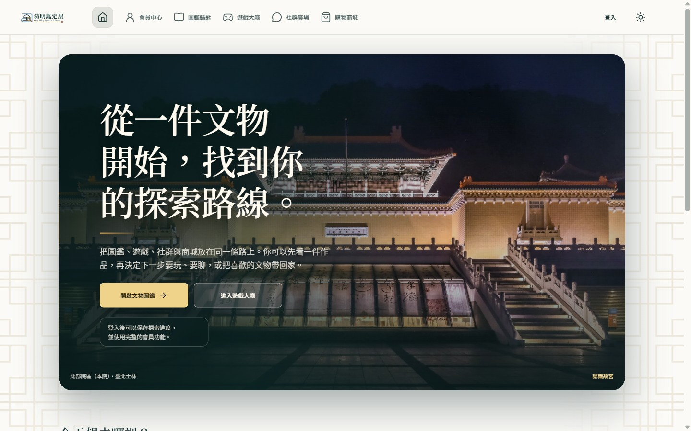
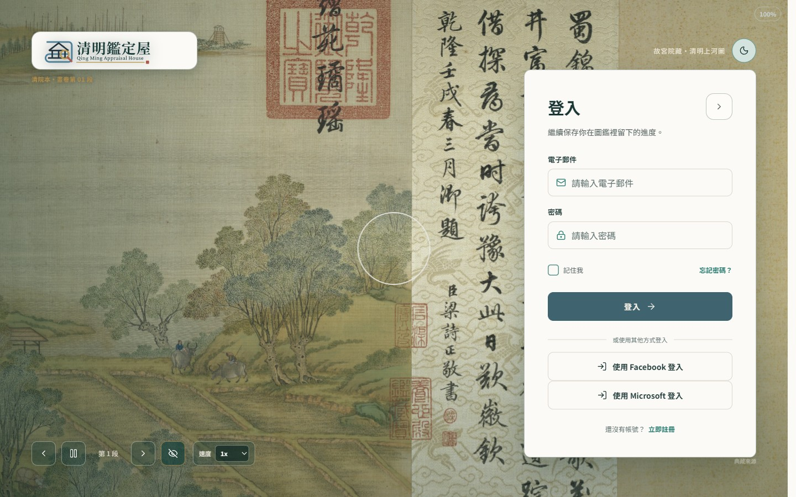
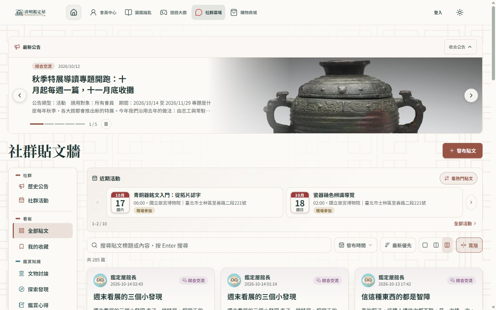
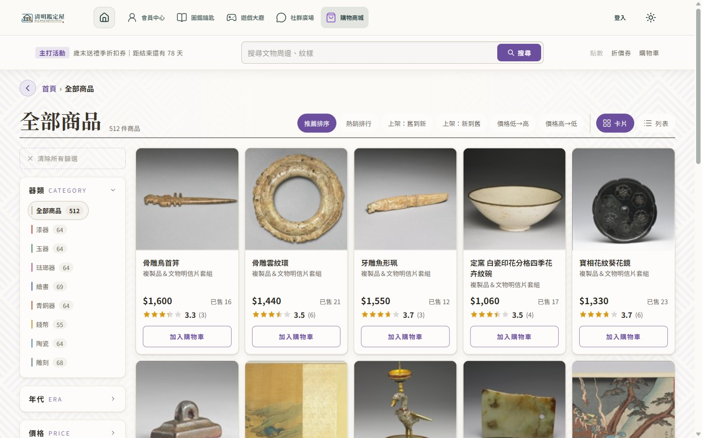
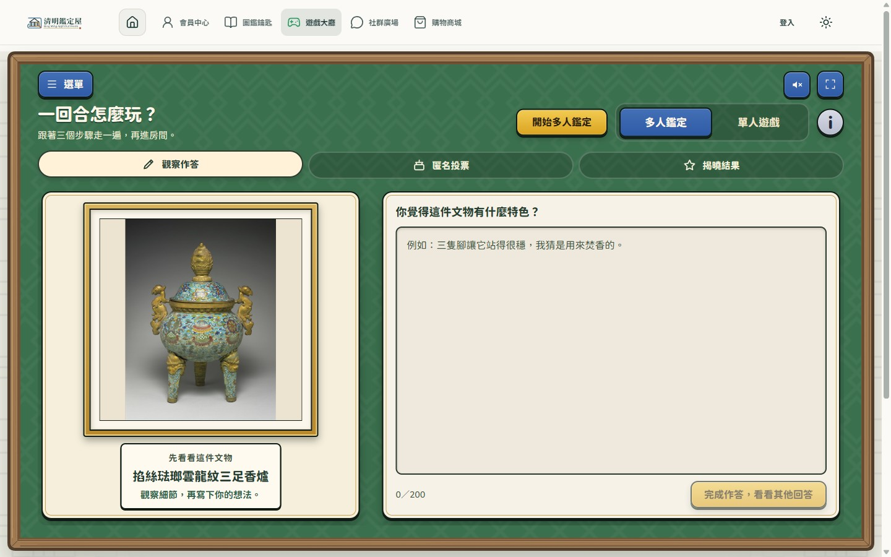

<p align="center">
  <picture>
    <source media="(prefers-color-scheme: dark)" srcset="QMAH.Media/images/brand/qmah-logo-dark.svg">
    <source media="(prefers-color-scheme: light)" srcset="QMAH.Media/images/brand/qmah-logo.svg">
    
  </picture>
</p>

# QMAH｜清明鑑定屋


[QMAH](https://github.com/MSIT173-03/QMAH) ｜ [QMAH-Database](https://github.com/MSIT173-03/QMAH-Database)

## 專案簡介

清明鑑定屋是資展國際「智慧應用微軟 C# 工程師養成班（MSIT173 期）」的結訓專題，由 5 位組員合作完成，已於 2026 年 10 月發表。名稱取自《清明上河圖》，以國立故宮博物院的開放文物資料為核心，做成一個可以逛圖鑑、玩鑑定遊戲、參與社群與逛商城的網站。

| 模組 | 內容 |
| --- | --- |
| Catalog 圖鑑 | 512 件文物、8 個分類、年代與來源授權標示 |
| Game 遊戲 | 四種單人小遊戲、多人鑑定房間、評分與每日獎勵 |
| Social 社群 | 貼文、留言、檢舉、活動、公告與通知 |
| User 會員 | 註冊登入（含 Cloudflare Turnstile）、個人資料、成就 |
| Store 商城 | 文物明信片示意商品、購物車、折價券、點數與訂單 |

商城商品是課程示意資料，沒有實際交易，也不代表故宮官方商品。

### 畫面預覽

| 首頁 | 登入 |
| --- | --- |
|  |  |
| **社群廣場** | **購物商城** |
|  |  |

**鑑定遊戲**



### 線上展示

專題發表後以 Azure 單台 VM 暫時部署，部署方式見 [deploy/azure-demo](deploy/azure-demo/README.md)。這是展示用環境，之後可能關閉，不保證長期可連線。

## 技術棧

- 後端：ASP.NET Core 10、Entity Framework Core（DB-first）、ASP.NET Core Identity、SignalR
- 前台：Angular 21.2、TypeScript 5.9、RxJS 7.8、SCSS
- 管理後台：ASP.NET Core MVC（Razor）
- 資料庫：SQL Server，結構以 SQL 為準，不使用 EF Migration
- 其他：Cloudflare Turnstile 人機驗證、GitHub Actions、Caddy（Azure 展示環境）

## 快速啟動

需要 Visual Studio 2026（含 ASP.NET and web development 工作負載）或 VS Code、.NET SDK 10.0.301 以上，以及符合 `QMAH.Client/package.json` engines 的 Node.js。

1. **還原資料庫**：到 [QMAH-Database 的 db-v1.0.10 Release](https://github.com/MSIT173-03/QMAH-Database/releases/tag/db-v1.0.10) 下載 `QMAH-1.0.10.bak` 與 `SHA256SUMS.txt`，核對校驗值後在 SSMS 還原成名為 `QMAH` 的資料庫。也可以改執行同版本的 `QMAH-1.0.10.sql`。目前相容的版本記錄在 [database/VERSION](database/VERSION)。程式啟動時不會建立資料庫或套用 Migration。
2. **啟動後端**：

   ```powershell
   dotnet run --project .\QMAH.Api\QMAH.Api.csproj --launch-profile https
   dotnet run --project .\QMAH.Web\QMAH.Web.csproj --launch-profile https
   ```

   API 在 `https://localhost:7249`，管理後台在 `https://localhost:7039`。在 Visual Studio 開啟 `QMAH.sln` 後，也可以直接選「QMAH 全站（API＋前台＋管理後台）」一次啟動。
3. **啟動前台**：

   ```powershell
   cd QMAH.Client
   npm start
   ```

   瀏覽器開啟 `http://localhost:4200/`。`npm start` 會在缺套件時自動執行 `npm ci`。

資料庫連線預設會自動尋找本機的 `QMAH`，需要固定目標時，在 `QMAH.Api/appsettings.Local.json` 與 `QMAH.Web/appsettings.Local.json` 覆寫 `QmahDatabase`（兩個檔案都不進版控，可參考同資料夾的 `appsettings.Local.example.json`）。資料工具用法見 [tools/QmahDataTools](tools/QmahDataTools/README.md)。

### 展示帳號

把根目錄的 `QMAH.DemoCredentials.csv`（密碼欄為空白範本）複製成 `QMAH.DemoCredentials.local.csv`，自行填入密碼後交給資料工具使用。`.local.csv` 已列入 `.gitignore`，不要提交。

### Turnstile 人機驗證設定

會員註冊使用 Cloudflare Turnstile。前端的 Site Key 可以公開，後端的 Secret Key 不行。

- 開發階段曾把一組 Secret Key 寫進 `QMAH.Api/appsettings.Development.json` 並提交到 GitHub，這組金鑰要視為已公開，不得用在任何正式環境。僅刪除檔案內容不會讓它失效，必須到 Cloudflare 重新產生（輪替）。
- 正式環境一律用環境變數 `Turnstile__SecretKey` 提供，不寫進任何版控檔案。
- 本機開發建議改用 [Cloudflare 官方測試金鑰](https://developers.cloudflare.com/turnstile/troubleshooting/testing/)，前端 Site Key 與後端 Secret Key 要成對更換。也可以把自己的金鑰放在不進版控的 `appsettings.Local.json` 或 `dotnet user-secrets`。

## 資料夾結構

```text
QMAH/
├─ QMAH.sln, QMAH.slnLaunch       方案與 Visual Studio 複合啟動設定
├─ QMAH.Api/                      REST API（/api/v1/*）
├─ QMAH.Web/                      Razor 管理後台，含五個 Area
├─ QMAH.Client/                   Angular 使用者前台
├─ QMAH.Infrastructure/           DB-first Entity、DbContext 與匯入核心
├─ QMAH.Media/                    共用媒體（文物圖、品牌、字型、頭貼與成就圖）
├─ database/                      Schema.sql 結構契約與 VERSION
├─ deploy/azure-demo/             Azure 展示環境部署腳本
├─ tools/                         資料處理與驗證工具
├─ docs/                          文件路標與介面設計基準
├─ .github/                       CI／CD 工作流程與 PR 範本
└─ QMAH.DemoCredentials.csv       展示帳號範本（不含密碼）
```

## 相關 Repository

| Repository | 內容 |
| --- | --- |
| [QMAH](https://github.com/MSIT173-03/QMAH) | 本 Repository，產品程式與 Schema |
| [QMAH-Database](https://github.com/MSIT173-03/QMAH-Database) | 可直接還原的完整資料庫 Snapshot 與版本歷史 |

## Git 協作

```text
feature/<area> → Pull Request → develop → Pull Request → main
```

功能分支為 `feature/game`、`feature/catalog`、`feature/social`、`feature/user`、`feature/store`。不 force push，也不改寫共同歷史。`.bak`、`bin`、`obj`、log、`.mdf`、`.ldf`、本機密碼與憑證檔都不提交。詳細規則見 [CONTRIBUTING.md](CONTRIBUTING.md)。

## 授權與資料來源

本 Repository 的程式碼採 [MIT License](LICENSE)。專題僅供學習、開發、測試與專題發表，不提供實際交易，也不做商業用途。下列文物資料與圖像不在 MIT 範圍內，依其原授權使用。

- 文物資料與圖像取自國立故宮博物院[典藏資料檢索－Open Data](https://digitalarchive.npm.gov.tw/opendata/)中明確標示開放的內容，依各資料頁所載的 CC0 或 CC BY 4.0 使用。需要標示姓名的素材，資料庫保留作品名稱、來源網址、授權代碼與 `AttributionText`，這些欄位不可移除。
- 本專題不使用來源商城的商品圖片或即時售價。
- 第三方字型、音效與圖示的授權檔放在對應資料夾（例如 `QMAH.Media/fonts`、`QMAH.Media/images/game`、`QMAH.Client/public/licenses`）。
- 素材權利標示需要補正時，請開 Issue 聯繫。
